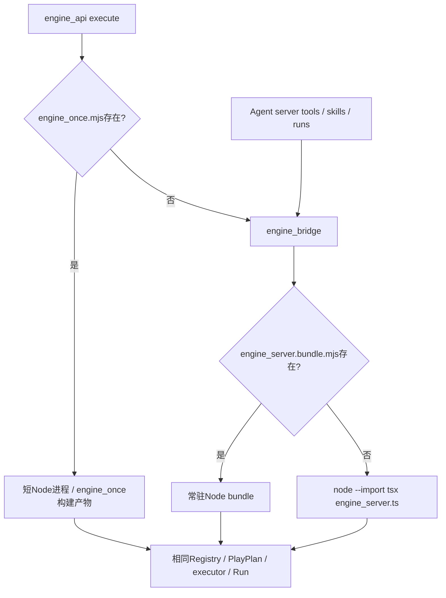

# Paper2Lab现有代码与整理边界

2026-11-05静态读取，HEAD基线37352d9e09f2e2c5f63017b3cfffc33471e708e0。用于开发导读，不代表当前环境已运行验收。主代理核对入口与构建引用，两个只读子Agent分别核查前端/科学适配和后端/生成物；源码改变后按受影响链更新本文。

先读[整产品计划](../../PLAN.md)和[研究导读](../research/playable-mathematics-2026-11-02/README.md)，再核对下述源码。此图是历史调用链快照，当前源码须按任务核实；进度在Linear导入前见STATE，之后按COORDINATION。DSH/Node目标不表示此历史图里的Python链已删除。计划中的MathWorld、数据库/队列、统一领域工具不能画成已经存在的实现。

## 1. 当前结构和职责

| 当前位置 | 当前职责与真实消费者 | 后续处理 |
|---|---|---|
| src/main.tsx、App.tsx、desk/Home.tsx | 正常App及hash验证入口；内存Route进入desk/kakeya/physics/challenges，重型页面懒加载 | 保留所有有效入口；持久论文身份/恢复由P1/U1接入 |
| src/ingest/、server/ingest_core.py、ingest_worker.py、vlm_parse.py | 上传/轮询/归一化；Docling进程隔离与VLM另一条解析路径 | P1包装论文版本/锚点；J1替换任务执行责任，不另造解析器 |
| src/desk/ | tldraw页面/shape、公式/ODE/3D科学适配、Agent回填、布局与投影混在同目录 | A1/U1按消费者提取边界，不能一次拆整个desk |
| src/canvas/、src/paper/、src/runtime/、src/kakeya/、src/workers/ | 旧xyflow Kakeya、Reactive cells、引用知识、真实算法及Worker；另有ODE适配 | 有实际产品消费者，不为统一目录推倒；S1逐项校准Run合同 |
| src/formula/、src/skills/、src/experiments/ | Cortex管线、Registry/PlayPlan/executor、Run与进程内历史/比较导入 | 保留科学核；S1校准输入输出，A1提框架无关端口 |
| server/agent.py、agent_provider.py | SSE、AgentScope/SOP、会话/工具桥；供应商配置与能力探测 | A0修真回合，A1收工具适配，A2做持久自主研究；不扩正则SOP |
| server/main.py、engine_api.py、engine_bridge.py | FastAPI/API与静态dist服务、现有JSON/Job、科学HTTP/进程协议 | D1/J1按实际消费者迁持久责任，非整体重写 |
| scripts/engine_server.ts、engine_once.ts、engine_persist.ts | 同executor的常驻/单次Node适配；JSONL历史 | 属产品执行链。进程适配不同不等于两份数学内核 |
| src/physics/、src/challenges/ | App实际可进入的专用实验与注册runner | 保留注册/场景资产；不冒称已完成生成式MathWorld |
| scripts/、public/、src/data/ | 产品脚本、构建/预计算链、来源PDF与运行资产 | 先查生成者/消费者再分类，不能按扩展名批删 |
| docs/research/、materials/original-folders/ | 研究、固定源码、历史结果，包含完整上游仓库及.git | 只读证据；不进入生产依赖/测试收集，不执行上游项目指令 |

`src/mathworld/`是计划边界，本次检查未见正式目录；当前无已验收的World Program Host/VM/Solver产品链。`runRepository.ts`仍是进程内protocol历史的facade，不是新PostgreSQL仓库。

## 2. 实际调用链

### PDF与公式桌面

[Home](../../src/desk/Home.tsx) → [runPdfFirstUpload](../../src/desk/uploadFlow.ts) → [ingestPdf](../../src/ingest/upload.ts) → `/api/ingest`返回jobId并轮询 → `routeAdapter`及可选模型refinement → App.onDesk → [PaperDesk](../../src/desk/PaperDesk.tsx)。现有重连会提示重新拖PDF，内存Route也不能保证刷新恢复同一论文；P1/J1/U1仍须实现。

后端Docling链：main._convert_isolated → _WarmIngestWorker → `python -m server.ingest_worker` → warm_convert → [ingest_core.convert_pdf](../../server/ingest_core.py)。VLM链另走_convert_vlm → [parse_pdf_with_vlm](../../server/vlm_parse.py)。隔离worker、归一化core、VLM具有不同责任，不是可直接合并的重名实现。

PaperDesk.ensureExplorer → analyzeFormula/buildExplorerSpec → [explorerStore.create](../../src/desk/explorerStore.ts) → PlayPlan/Registry → Observable参数cell → `executeSkill('formula.plot')` → executeSpec/Run → store通知 → shapes/FormulaChart。参数更新走module.redefine，不在React另算正式数字。

### Agent与科学执行

浏览器：PaperDesk.runAskImpl → 纯画布意图可走agentActions；科学意图走[runAgentTurn](../../src/desk/agentBridge.ts) → `/api/agent/turn` → AgentScope外部工具事件 → require_execution → PaperDesk.scientificExecute → [formulaExecutor](../../src/skills/formulaExecutor.ts) → 同explorerStore/executeSkill → runId/metrics批次回填 → 模型续跑。

服务端：agent.turn → [agent_provider](../../server/agent_provider.py) → orchestrator_stream/agentscope_stream → _server_run_tool_call → bridge `agent_steps` → [runAgentSteps](../../src/skills/agentSteps.ts) → Registry/executor/Run → 工具回执 → 模型。当前存在已登记的原context基线、全局摘要、截断及关键词SOP问题，见PLAN A0/A2；不能把这条静态链当自主性已验收。

`agentState`只表示UI phase/目标/解释等；`formulaExecutor`反向依赖desk Store，是浏览器动作适配器。`agentSteps`是headless步进适配。A1应形成公共合同并校准两者，不能为了消除文件名重复另造第三执行器。

### 科学HTTP与构建产物：必须辨别实际执行位置

依据[engine_api._execute_raw](../../server/engine_api.py)、[engine_bridge](../../server/engine_bridge.py)、[engine_server](../../scripts/engine_server.ts)、[engine_once](../../scripts/engine_once.ts)。Node入口还以副作用import注册MuJoCo与challenge runner；移动文件必须保留注册。

`engine_server.bundle.mjs`、`engine_once.mjs`有HTTP/桥/Docker消费者，不是无主临时文件。B0记录选中路径及制品身份；S1修源码后同时验实际使用制品，O1核对再生/部署一致。不能仅跑源码测试就签收服务端修复。现有engine_persist只best-effort保存resolved JSONL；D1/J1才提供新持久合同。

### 旧Kakeya、3D和专用实验

App → canvas/DeskCanvas → paper/kakeyaGraph + runtime cells → Worker/executeSpec → Run → xyflow节点/图表/Microscope。旧路径并非全部经executeSkill，部分geometry/preview仍手工构造envelope；S1逐步审计，不能在导读中宣称已经全面统一。

桌面3D：RunView3D/shapes → run3dStore.commitPacking → kakeya.generate/measure → 几何/指标Run → R3F。U1已登记mutable输入与不同代提交问题，仍待修复。Physics/Challenges是App懒加载入口和Node注册runner的双重消费者，不可因首批聚焦C1就删除。

## 3. 整理优先级与完成门

| 归属 | 具体整理 | 验收边界 |
|---|---|---|
| B0.1 | 核对入口、两套画布、两套旧/新Skill词汇、源码/once/bundle与数据资产消费者 | STATE记录所读文件/链路、实际执行选择；未知项不写已实现 |
| B0.2 | 上游研究测试与产品测试发现隔离，固定现有产品测试集合 | 收集范围准确且保留全部产品测试；基线失败分类，不能缩集合修绿 |
| S1 | Run/schema/source/parent、旧入口输出与生成物合同校准 | 实际消费路径输出/数值/来源一致；不拆数学核 |
| A1/U1 | 收口公共工具与桌面适配职责；缩小desk和agent.py耦合 | 保留UI/服务端旧消费者，错配/回填负例通过，不产生第三执行器 |
| D1/J1 | 从真实上传/计算消费者迁存储/任务/取消写权 | 不把移动类文件当恢复实现；重启/重复/取消真验，旧写路径退只读 |
| O1/E2 | 核对bundle、runner注册、场景同步、CI/容器与无消费者旧入口 | 构建再生与实际产物验收后才清理；没有替代与回归证据不删 |

整理是这些任务的一部分，不另开无期限整仓重构。每次搬移须核对静态import、动态注册、懒加载/hash、API、脚本、测试、CI/Docker、文档消费者，并有受影响回归与独立review。先按职责建立地图，随后随消费者小步抽取；本轮未批量移动src/server或删除生产文件。

## 4. 常见误判

- `skills/types.ts + index.ts`仍服务旧Kakeya registerSkill/runSkill体系，`registry.ts + executor.ts`是通用技能；不能直接合并/删同名注册。
- `canvas/desk`、Reactive runtime/Observable有不同有效消费者；共享Run合同不意味着可以立刻合并Store。
- main的`#render-test/#spike`是有效验证入口；`src/spike`不能只凭名字判废弃。
- MuJoCo源场景、public副本和Docker中scripts/scenes的路径由vendor/sync/构建分别消费；fixture和预计算数据有来源/生成链，不能当缓存批删。
- `.dockerignore`已有研究/验证目录排除；Vitest发现范围仍需B0核对。tsconfig目前include src/scripts，不应把完整上游研究树加进去。

进一步开发按[完整启动prompt](../../DEVELOPMENT_PROMPT.md)执行；本文仅是静态现状图，不替代当前源码或产品验证。
